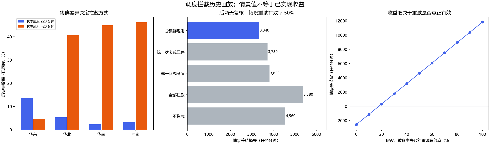

# 我会怎么减少这批任务的超时等待

我想先解决一个具体问题：任务派出去之前，能不能提前发现一部分容易超时的情况，少让用户白等两个小时。

这次最值得注意的发现是，四个集群的问题不太一样。华北、华南和西南，节点状态很久没更新的任务更容易失败；华东则是剩余显存低的任务更容易失败。所以我的方案是分开检查，而不是给所有集群套同一条规则。

这次用了 Codex 协助分析、写代码和核对结果，具体过程放在 [AI_LOG.md](AI_LOG.md)。仓库里有分析脚本、检查规则和每个任务的判断结果。目前做到的是用历史数据检查方案，还没有接到真实调度系统里。

## 1. 先把这份数据算清楚

分析只用了题目给的 [task_dispatches.csv](data/task_dispatches.csv)。原文件保留在仓库里，下面是它的 SHA-256，方便核对是不是同一份数据：

```text
eee43768b46617993c23942029dd4b77d238c46fd76cc215ef7532fbb7386a1a
```

| 检查 | 结果与处理 |
| --- | --- |
| 原始行数 | 1,138 |
| 完全重复行 | 54，只删除八个原始字段全部相同的重复副本 |
| 去重后唯一任务 | 1,084；没有剩余冲突 task_id |
| 结果已回传 | 1,037：892 成功、145 超时崩溃；失败率 13.98% |
| 未回传 | 47，单独保留，不填成成功或失败；原始文件有 49 个空结果，另 2 个是重复副本 |
| 时间范围 | 北京时间 2026-09-01 07:04 至 2026-09-07 21:58 |
| 时间与数值异常 | 无时间解析失败、负状态延迟或负显存/负载值 |

这里有两个地方很容易算错。一个是时间：派发时间用了 `+08:00`，状态更新时间用了 `Z`，所以脚本先把它们统一成 UTC，再用 `status_age_min = dispatch_time - status_synced_at` 算间隔。按天统计时再转回北京时间，不能直接把两个时间字符串相减。另一个是显存为 0 的记录，它有实际含义，我保留了，没有当成缺失值。

重复记录也得先处理。这 54 行是八个字段完全相同的副本，没有证据说明它们是新的重试，所以只算一次。后面的失败率都只用已经回传结果的任务来算；说“拦到了多少比例的全部任务”时，才把未回传的任务一起算进去。除了结果字段，没有发现其他字段缺失。详细检查结果在 [summary.json](outputs/summary.json)，删去的重复副本在[这里](outputs/duplicate_rows.csv)。

## 2. 为什么我觉得应该分集群处理

### 三个集群的问题，都和状态长时间没更新有关

| 集群 | 状态延迟 ≤20 分钟：失败/已回传 | >20 分钟：失败/已回传 |
| --- | --- | --- |
| 华北通用算力池 | 10/187，5.35% | 26/64，40.63% |
| 华南视频渲染池 | 4/177，2.26% | 31/69，44.93% |
| 西南音视频节点组 | 6/189，3.17% | 37/80，46.25% |
| 华东推理集群 | 28/207，13.53% | 3/64，4.69% |

把华北、华南和西南合起来看，超过 20 分钟没更新状态的任务，213 个里失败了 94 个，失败率是 44.13%；20 分钟以内的任务，553 个里失败了 20 个，失败率是 3.62%。前者大约是后者的 12.2 倍，值得优先处理。

但华东刚好不是这个方向。如果只看全平台的平均结果，很容易得出“状态超过 20 分钟就全部拦截”的结论，华东就会被一起误拦。[分组数字和 Wilson 95% 区间在这里](outputs/cluster_staleness.csv)。

### 华东更明显的问题是低显存

华东剩余显存 `<4 GB` 的任务，44 个里失败了 26 个，失败率是 59.09%；`≥4 GB` 的任务，227 个里只失败了 5 个，失败率是 2.20%。低显存组的 Wilson 95% 区间是 44.41%–72.31%，样本还不算多，但差异已经比较明显。[详细分组在这里](outputs/cluster_vram.csv)。

我的判断是，可以先沿着状态更新和显存占用这两个方向查。不过，这份表还不能直接证明是心跳丢失或者显存不足导致了崩溃。它没有 node_id、节点心跳、任务实际需要多少显存、错误码、队列长度和重试链路，所以还定位不到具体节点，也解释不了全部原因。华东旧状态组失败率低，也不能理解成状态越旧越安全，可能还有没记录下来的影响因素。

### 任务类型和输入大小，这次先不拿来设规则

按任务类型分组，整体失败率在 11.43%–18.42% 之间，没有前面两个信号那么明显。输入大于 80 MB 的任务确实失败得更多，21 个已回传任务里失败了 7 个，但样本太少，也可能受集群等其他因素影响。

所以这次先不加这些条件，避免规则越写越复杂。而且素材有多少 MB，并不等于执行时需要多少 GB 显存，不能直接换算。[任务类型](outputs/task_type.csv)、[输入大小](outputs/payload.csv)和[交叉分组](outputs/cluster_interactions.csv)的结果都保留了。



## 3. 我把方案做成了什么

方案落在 [policy.py](policy.py) 里的 `decide` 函数。它只看派发时就能拿到的信息，不会拿任务最后成功还是失败来做判断：

```python
from policy import decide

# 使用实际任务字段调用；函数不读取 is_success
decision = decide(cluster_name, node_free_vram, dispatch_time, status_synced_at)
```

现在的规则很直接：

1. 华东显存 `<4 GB`，先拦下来检查，返回 `RECHECK_AND_REROUTE`。
2. 华北、华南、西南超过 20 分钟没更新状态，同样返回 `RECHECK_AND_REROUTE`。
3. 没有这些情况就返回 `PASS`，意思只是这条规则没发现问题，后面原有的资源检查还要照常做。
4. 集群不认识、显存缺失或不合法、时间格式不对、没有时区，或者同步时间晚于派发时间，就返回 `RECHECK`。自定义阈值也要是有限的非负数，不合法就先检查，不能直接放行。如果已经自动重试过一次，返回 `ESCALATE`，不让任务一直来回重试。

这里的 4 GB，只是这份数据里华东的风险分界，不能理解成所有模型有 4 GB 就能跑。比如其他集群显存为 0，在这条规则里可能得到 PASS，但原有的资源检查仍然应该挡住它。

如果接入真实系统，我会先刷新命中节点的心跳和显存，再核对这次任务到底需要多少资源。确实不适合跑，才换一个健康且资源足够的节点，并在派发前把资源占住，防止多个任务同时抢同一份显存。自动切流最多一次，没有合适节点就进入有等待上限的队列，并给用户提示。

目前写好的是判断函数和历史数据回放。刷新心跳、预留资源和真正切换节点还没有实现。这份数据也不足以指定应该切到哪个节点或哪个集群。

## 4. 20 分钟和 4 GB 是怎么选的

先用前五天，也就是 9 月 1–5 日的数据选阈值。这部分有 756 个任务，727 个已经回传结果。再固定选出来的规则，看它在后两天表现怎么样；后两天有 328 个任务，310 个已经回传。

脚本比较了这些取值：

- 状态间隔：`[5,10,15,20,25,30,40,50,60]` 分钟。
- 华东显存：`[0,2,4,6,8,10,12]` GB。

两两组合一共 63 组。比较时按题目给的 120 分钟失败损失、10 分钟拦截成本来算，另外先**假设重试有效率 q 是 50%**。哪组在前五天算下来的净节省最多，就先选哪组。如果一样，就先选拦截更少的，再按阈值从小到大的顺序确定结果。

这样选出来的是 `>20 分钟` 和 `<4 GB`。[完整搜索结果](outputs/threshold_search_train_only.csv)可以直接查看。也不能把 4 GB 看得太精确：换成 6 GB，前五天算出的净节省是 3,290 分钟，4 GB 是 3,410 分钟，差距没有大到可以忽略后续验证。

这一步有个局限需要说清楚：分析一开始就看过全量数据，分集群这个思路也来自这些数据。所以后两天只能用来检查结果是不是相对稳定，不能算一份完全没见过的测试数据，更不能证明上线后一定有效。派发规则本身没有用 task_id 和结果标签，也没有把重复记录随机分到不同组里。

## 5. 到底能拦到多少失败，值不值得做

### 先看它拦到了哪些任务

| 指标 | 前五天 | 后两天复核 | 全周描述性回放 |
| --- | ---: | ---: | ---: |
| 全部唯一任务 | 756 | 328 | 1,084 |
| 已回传任务 | 727 | 310 | 1,037 |
| 命中任务（含未回传） | 191 | 74 | 265 |
| 命中已回传任务 | 187 | 70 | 257 |
| 命中历史失败 TP | 88 | 32 | 120 |
| 命中历史成功 FP | 99 | 38 | 137 |
| 未命中历史失败 FN | 19 | 6 | 25 |
| 失败覆盖率 | 82.24% | 84.21% | 82.76% |
| 命中组历史失败率 | 47.06% | 45.71% | 46.69% |

用整周数据跑下来，规则会拦到 24.45% 的任务，里面包含 82.76% 的已知失败。这个覆盖率值得继续验证，但代价也很清楚：137 个原本会成功的任务也会被拦下来，多花一次检查或切流的时间。[每个任务的判断结果都在这里](outputs/dispatch_decisions.csv)。

命中任务的历史失败率是 46.69%，Wilson 95% 区间是 40.69%–52.80%；后两天对应的区间是 34.57%–57.30%。这些区间只是提醒样本比例还有不确定性，不能拿来当上线收益的保证。

### 拦到了失败，不代表一定能把它救回来

这是算收益时最需要小心的一点。旧节点跑失败了，换一个节点是否就能成功，这份 CSV 没有告诉我们。所以这里用了一个参数 q：被拦到的历史失败里，有多少能通过一次检查或切流，避开那 120 分钟的超时损失。q 是假设，不是从表里统计出来的成功率。

为了让计算能复核，公式里用 F 表示历史失败数，TP 表示被拦到的历史失败数，H 表示被拦到且已有结果的全部任务数，也就是 `TP+FP`：

```text
基线等待损失       = 120 × F
策略情景等待损失   = 120 × (F - q × TP) + 10 × H
情景净节省         = 120 × q × TP - 10 × H
盈亏平衡 q         = 10 × H / (120 × TP)
```

说白了，就是先算少了多少次超时，再扣掉所有被拦任务多花的时间，原本会成功的任务也要扣。如果重试没用，原来那 120 分钟损失仍然算进去。

这里还假设新节点有足够容量，而且切流不会额外把原本成功的任务弄失败。加起来的单位是“任务分钟”，表示所有任务各自损失的时间总和，不是说一个用户或者整个平台连续等了这么久，也不是完整的端到端耗时。

| 已回传样本 | q=0% | q=20% | q=50% | q=100%（理想上限情景） |
| --- | ---: | ---: | ---: | ---: |
| 后两天净节省，分钟 | -700 | 68 | 1,220 | 3,140 |
| 全周净节省，分钟 | -2,570 | 310 | 4,630 | 11,830 |

如果被拦到的失败有一半能通过重试避开，也就是 **q=50%**，后两天算出的等待损失会从 4,560 降到 3,340 任务分钟，少 1,220，约 26.75%；整周算下来少 4,630，约 26.61%。我会把这说成“在这个假设下可能节省多少”，现在还不能说已经节省了这些时间。

反过来看，整周至少要有 17.85% 的命中失败能被重试救回，才够抵掉拦截成本；按后两天算是 18.23%。低于这个比例，折腾一圈反而可能让用户等更久。假如切流还让一部分原本成功的任务失败，收益也得再扣，公式是 `120 × r × FP`，r 就是这部分额外失败的比例。现在没有数据能估计它。

还有 8 个被拦到的任务没回传结果，上表没有擅自给它们补标签。在 q=50% 时，如果这 8 个原本都会成功，把它们的拦截成本也算上，整周净节省是 4,550；如果它们原本都会失败，则是 5,030。这只是按同一套假设算两种边界，不代表未回传任务没有偏差。其他 q 取值的结果放在[这张表](outputs/retry_effectiveness_sensitivity.csv)里。

### 为什么不干脆多拦一点

为了看清这个取舍，下面把阈值和 q=50% 的假设固定住，对比后两天 310 个已回传任务：

| 策略 | 拦截已回传 | 覆盖历史失败 | 误拦历史成功 | 情景等待损失，分钟 |
| --- | ---: | ---: | ---: | ---: |
| 不拦截 | 0 | 0 | 0 | 4,560 |
| 全部拦截 | 310 | 38 | 272 | 5,380 |
| 所有集群状态 >20 分钟 | 82 | 26 | 56 | 3,820 |
| 所有集群状态 >20 分钟或显存 <4 GB | 109 | 32 | 77 | 3,730 |
| 分集群规则 | 70 | 32 | 38 | 3,340 |

可以看到，分集群和统一的“状态旧或显存低就拦”都拦到了 32 个历史失败，但分集群少拦了 39 个原本成功的任务，少付 390 任务分钟。这就是我选择它的主要理由：尽量保留失败覆盖，同时减少不必要的等待。当然，这还是历史数据上的比较，得拿新任务继续验证。[每天的结果](outputs/daily_policy_replay.csv)和[所有策略的完整结果](outputs/policy_comparison.csv)也都保留了。

## 6. 如果要上线，我接下来会怎么做

1. **先只记录，不真的拦。** 看新任务会命中哪些规则，同时补上节点 ID、状态版本、实时显存、任务显存需求、错误码、实际等待、重试关联、切流目标和排队时间。先查清楚失败到底是怎么发生的。
2. **再拿小部分流量试。** 按集群和任务类型分组做随机对照，阈值固定，最多自动重试一次。最好用独立节点池或按时间块切换，避免两组共用节点、互相抢资源，影响比较。实验分组和规则版本都要记录下来。
3. **主要看用户实际少等了多久。** 统计每个提交任务因调度失败、检查和切流多等的分钟数，再看失败率、中位数和 P95 等待、误拦、切流成功率、目标容量和排队时间。没回传的任务继续追踪，不能直接删掉。
4. **提前约好怎样才算有效。** 希望实验组平均等待确实比对照少，等待差值的置信区间上界也低于 0，同时 P95 等待和成功率不变差。观察多久、需要多少样本，要先根据记录到的等待波动和希望达到的改善量来定。这份表没有真实耗时，现在算不出可靠的样本量。
5. **效果不对就停。** 如果重试救回的失败不够抵成本、目标队列或容量吃紧，或者成功率和 P95 等待超出事先约好的恶化范围，就回滚。具体警戒线要先看正常运行时的基线，再定下来。

后面还可以给节点状态设有效期，断连的节点先暂停接任务；派发前检查并占好显存；同一个任务重试时用唯一标识防止重复执行，并限制次数。这些都要按集群分别看效果，不能简单把任务全挪到某一个集群。现在没有节点容量和执行时长，暂时也没有依据去定负载均衡的具体权重。

## 7. 想核对结果，可以这样跑

这次使用 Python 3.12，在仓库根目录执行下面几条命令就能重算结果并跑测试：

```powershell
python -m venv .venv
.\.venv\Scripts\python.exe -m pip install -r requirements.txt
.\.venv\Scripts\python.exe evaluate.py
.\.venv\Scripts\python.exe -m unittest -v
```

其他系统也可以在环境里直接运行 `python evaluate.py` 和 `python -m unittest -v`。依赖版本放在 [requirements.txt](requirements.txt)。如果想换一个 q 来重新选规则，可以运行 `python evaluate.py --retry-effectiveness 0.2 --out outputs_q20`。注意这会重新选阈值；如果只是想看当前 20 分钟/4 GB 规则在不同 q 下的收益，直接看默认生成的敏感性 CSV 就可以。

- `evaluate.py`：从原始数据重算审计、分组、搜索、时间复核、成本敏感性和图表。
- `policy.py`：线上可复用的无标签判断函数，默认 20 分钟/4 GB。
- `outputs/summary.json`：所有主结论的机器可读数据与输入哈希。
- `outputs/dispatch_decisions.csv`：全部 1,084 个唯一任务的特征、历史标签、动作和理由。
- `test_policy.py`：阈值边界、混合时区、异常状态、重试预算测试，以及用标准库独立核对真实 CSV 的计数和收益算式。
- `analysis.py`：作答前准备的通用 CSV 结构检查工具，不承担本报告的业务计算。
- `AI_LOG.md`：关键提示词、AI 错误、修正与取舍。测试中的合成输入只用于软件检查，没有用于业务结论。

图表用了 Microsoft YaHei 字体，其他电脑没有这个字体时可能提示缺字体，但 CSV 和 JSON 的数字不受影响。运行不需要额外下载业务数据，也不依赖在线服务。

## 8. 这次没做完的部分

时间有限，这次优先把数据怎么算、规则为什么这样选、误拦要付什么代价，以及收益依赖哪些假设讲清楚，没有做复杂预测模型或网页。

现在只有七天数据，还有 47 个任务没回传结果，它们也不一定是随机缺失的。缺少节点标识、重试链路和真实耗时，根因、任务之间是否独立、换过去有没有容量、切流到底能不能救回来，都还没法确认。

如果继续做，我会先固定当前规则，拿新一周的数据检查，再做小流量实验。比起继续在这一份表里调出更漂亮的数字，我更想知道这套办法对新任务到底有没有用。

### 后续修改记录

- 2026-10-18：把作答前模板替换成正式分析，补齐代码、结果和验证计划。
- 2026-10-18：把说明改成更接近口头讲解的写法，方便阅读和复述；数据、计算方法、规则及结论没有改变。
- 2026-10-18：复查时补上自定义阈值校验，避免 NaN 等异常参数绕过检查。默认规则和业务结果没有变化，测试增至七项。
